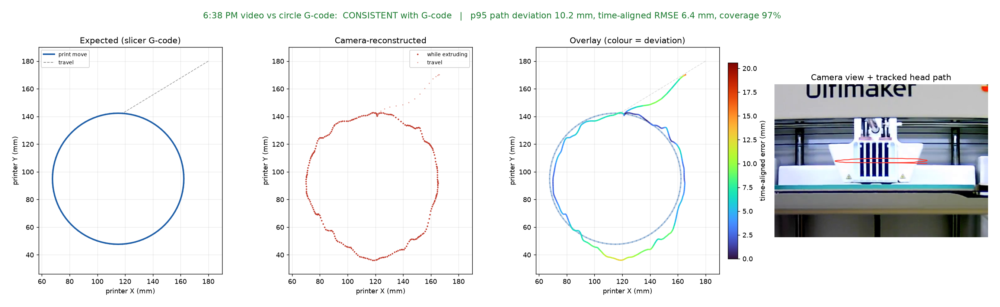

# VSU thesis: camera-based G-code integrity for 3D printing

One camera watches an Ultimaker S3. The code tracks the print head with a
trained YOLO model, maps it to printer X/Y (mm) with a calibration learned from
a print whose G-code is known, and checks whether the printed first layer
matches the slicer G-code.

- Start here: [capture/docs/integrity.md](capture/docs/integrity.md) — commands, method, results, limitations, next ideas
- Project guide and other tools (GUI, top camera, training): [capture/docs/README.md](capture/docs/README.md)

```bash
cd capture
pip install -r requirements.txt
python application/integrity_check.py --help
python -m unittest discover -s tests
```


