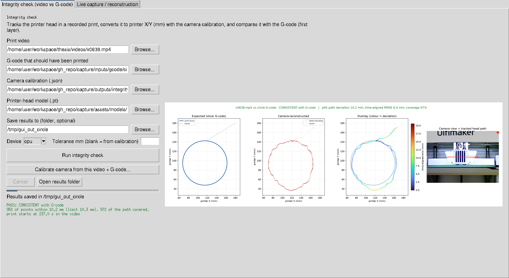
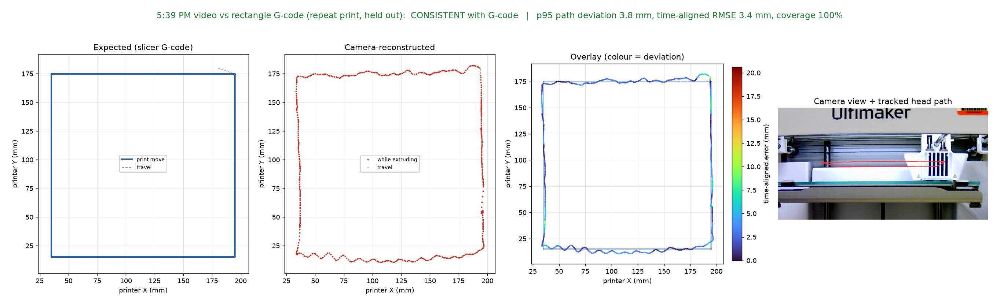
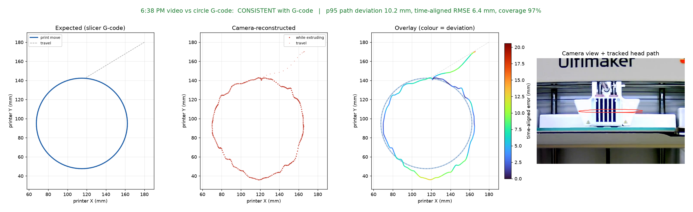
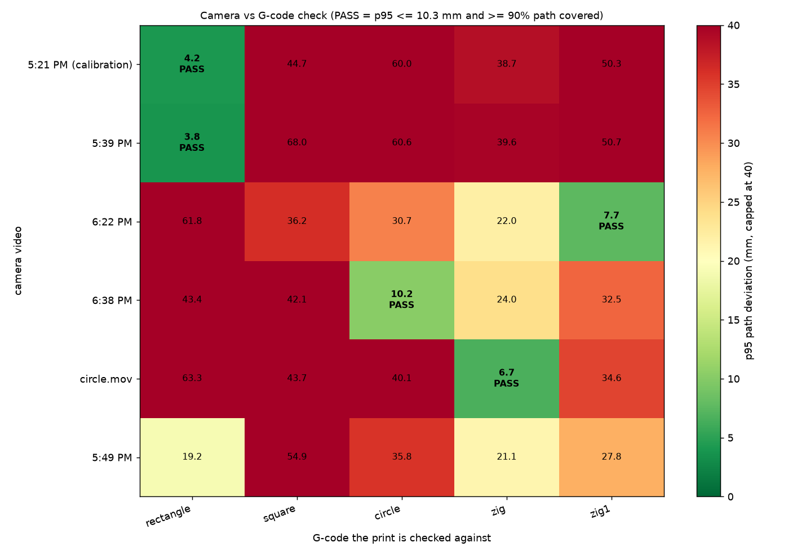

# Camera vs G-code integrity check (single layer, front/side camera)

This is the end-to-end pipeline that answers the thesis question for one
layer: *did the printer head move the way the slicer G-code said it would?*

```
video ──► track (YOLO printer-head box per frame) ──► calibrate once (known print)
                                                         │
G-code ──► commanded timeline (trapezoid + jerk planner) ─┴─► compare ──► side_by_side.png
                                                                        timeseries.png
                                                                        comparison.json
                                                                        observed_bed_path.csv
```

Code lives in `backend/integrity/` (layers: `gcode_timeline` → `track` →
`mapping` → `align` → `compare`) and the command-line entry point is
`application/integrity_check.py`.

## Desktop app

```bash
python application/gui.py      # opens on the "Integrity check" tab
```

Choose the print video and its G-code; the calibration and model fields are
pre-filled. Saved head tracks in `outputs/integrity/tracks/` (matched by the
original recording name) are reused, so the six 10-8-26 videos check in a few
seconds. New videos are tracked once (a few minutes on CPU, choose `mps` on an
Apple-silicon Mac) and the track is saved for next time.



## Commands

Run from `capture/` (Python 3.10+, `pip install -r requirements.txt`).
Raw videos are not in git; put them (or links to them) in `inputs/videos/`. The default model is
`assets/models/printer_head/best.pt` (the trained printer-head detector).

```bash
# 1. Track the head in every video (headless; coarse pass, then dense pass where the head moves)
python application/integrity_check.py track --video "inputs/videos/Movie on 10-8-26 at 5.21 PM.mov" \
    --output outputs/integrity/tracks/v0521.csv          # add --device mps on an Apple-silicon Mac

# 2. Calibrate the camera ONCE from a print whose G-code you trust (rectangle, 5:21 PM video)
python application/integrity_check.py calibrate --track outputs/integrity/tracks/v0521.csv \
    --gcode inputs/gcode/rectangle/model.gcode --output outputs/integrity/calibration.json

# 3. Check another print against the G-code that was supposed to run
python application/integrity_check.py compare --track outputs/integrity/tracks/v0622.csv \
    --gcode inputs/gcode/zig1/model.gcode --calibration outputs/integrity/calibration.json \
    --video "inputs/videos/Movie on 10-8-26 at 6.22 PM.mov" --output-dir outputs/integrity/v0622_zig1

# 4. Every video against every G-code (shows the check can tell prints apart)
python application/integrity_check.py matrix --calibration outputs/integrity/calibration.json \
    --track rect=outputs/integrity/tracks/v0521.csv --track zig1=outputs/integrity/tracks/v0622.csv \
    --gcode rect=inputs/gcode/rectangle/model.gcode --gcode zig1=inputs/gcode/zig1/model.gcode \
    --output-dir outputs/integrity/matrix
```

`run` = `track` + `compare` in one command. Tracks for all six 10-8-26
videos are already saved in `outputs/integrity/tracks/`, so steps 2–4 run in
seconds without the videos (tracking takes ~0.2 s/frame on CPU, only for the
frames where the head moves).

Note on the older side-camera tools: `cameras/side/printer_xy_calibration.py`
defaults to `depth_axis="X"`. For this camera (looking at the front of the
printer) depth is printer **Y**; the new calibration records
`"depth_axis": "Y"` explicitly.

## How it works

1. **Commanded timeline** (`gcode_timeline.py`). Only the print section is used
   (from `;LAYER_COUNT` to the last extruding move); homing, active levelling
   and the G280 prime are firmware-driven and not in the file. Each move is
   timed with the active `M204` acceleration, the `F` feedrate and the `M205`
   jerk limit at corners, with forward/backward look-ahead. Adding the jerk
   planner moved the fitted time scale for the 97-segment circle from 0.82 to
   1.04, i.e. the model now predicts real print timing within a few percent.
2. **Tracking** (`track.py`). The trained YOLO printer-head model finds the
   head box in every frame (the most confident box is kept). A stride-15 pass
   finds when the head moves; a dense pass runs only there. Box centre gives
   the image-horizontal position; box width gives distance from the camera.
3. **Camera calibration from a video + G-code** (`mapping.py`, `calibrate`).
   The camera faces the front of the printer, so printer **X is image
   horizontal and printer Y is depth**. A pinhole model gives
   `X ≈ a·(u/w) + b·(1/w) + c` and `Y ≈ f/w + g`; the default
   `pinhole_plus` model adds small lens/yaw/height terms. Because the G-code
   says where the head *should* be at each instant, the rectangle print is a
   calibration target with ~535 known points: the code searches the print
   start time and speed scale, fits the mapping, re-registers, and refits.
   Accuracy is reported on held-out data (fit on even 1-s blocks, test on odd).
4. **Comparison** (`align.py`, `compare.py`). For a new video the mapping is
   fixed and only the time offset/scale are searched. Metrics:
   time-aligned RMSE, path deviation (each observed point to the nearest
   commanded print segment), coverage (share of the commanded path with an
   observed point within tolerance) and Hausdorff distance. Verdict:
   **CONSISTENT** if p95 path deviation ≤ tolerance and coverage ≥ 90%.
   The default tolerance is 2.5 × the calibration held-out RMSE (min 5 mm),
   so a better calibration automatically gives a stricter check.

## Results on the 10-8-26 recordings (calibration = 5:21 PM rectangle)

Calibration: fit RMSE 3.4 mm, **held-out RMSE 4.1 mm** over X 35–195 mm,
Y 15–180 mm (plain pinhole without the extra terms: 8.6 mm). Tolerance 10.3 mm.

| Video (10-8-26) | Printed G-code (found automatically) | Print starts in video | Time scale | p95 path deviation | Coverage | Verdict | Figure |
| --- | --- | --- | --- | --- | --- | --- | --- |
| 5:21 PM | rectangle (calibration, in-sample) | 367.2 s | 0.99 | 4.2 mm | 100% | CONSISTENT | [side-by-side](../outputs/integrity/v0521_rectangle_calibration/side_by_side.png) |
| 5:39 PM | rectangle (repeat print, **held out**) | 261.6 s | 0.99 | 3.8 mm | 100% | CONSISTENT | [side-by-side](../outputs/integrity/v0539_rectangle/side_by_side.png) |
| 6:22 PM | zig1 (4 strokes) | 363.8 s | 1.02 | 7.7 mm | 100% | CONSISTENT | [side-by-side](../outputs/integrity/v0622_zig1/side_by_side.png) |
| 6:38 PM | circle | 237.0 s | 1.04 | 10.2 mm | 97% | CONSISTENT | [side-by-side](../outputs/integrity/v0638_circle/side_by_side.png) |
| circle.mov | **zig** (6 strokes) — the file name is misleading | 258.2 s | 1.02 | 6.7 mm | 100% | CONSISTENT | [side-by-side](../outputs/integrity/circlemov_zig/side_by_side.png) |
| 5:39 PM vs wrong file | circle (negative control) | — | — | 60.6 mm | 0% | DEVIATES | [side-by-side](../outputs/integrity/v0539_vs_wrong_circle/side_by_side.png) |
| 5:49 PM | none of the five files in `builds/` | — | — | ≥ 19 mm | — | no match | — |




The matrix below runs every video against every G-code. The correct G-code is
the only PASS in each row, and the next-closest wrong G-code is at least
~2× further away. That separation is the thesis evidence that a single camera
can tell whether the commanded first layer was printed.



## Limitations (state these in the thesis)

- **First layer only.** The calibration is valid at the bed height it was fitted
  at. Higher layers move the bed down (Ultimaker S3 moves the bed in Z), which
  changes the head's image height; see ideas below.
- **Head box, not nozzle tip.** YOLO tracks the print-head housing; ~4 mm
  residual wobble in Y comes from box-width jitter (depth from width is the
  weakest axis). Coverage and path deviation are robust to this, time-aligned
  RMSE less so.
- **Timing model is approximate.** A global time scale (0.85–1.35) is fitted;
  the jerk planner keeps it near 1.0 for these prints.
- **No extrusion sensing yet.** The check proves *where the head went*, not that
  plastic came out (a missing-extrusion or wrong-material attack would pass).
- One video (5:49 PM) contains motion that does not match any of the five
  G-code files in `builds/` (small square plus a larger ~120 × 125 mm loop over
  ~48 s); its G-code file is needed to evaluate it.

## Ideas to extend it (tied to the project papers)

1. **Timing-attack detection (Sophos).** Sophos models G-code spatiotemporally
   and compares it with independently measured printer state
   (https://doi.org/10.1145/3450267.3450545). Our pipeline already produces a
   per-move commanded timeline; lock the time scale to the calibrated value and
   flag per-segment timing residuals. This catches speed/dwell changes that
   keep the geometry identical (e.g. modified feedrate to weaken parts).
2. **G-code reconstruction from video (One Video to Steal Them All).** That
   paper reconstructs printer trajectories from video as a side channel
   (https://doi.org/10.1145/3719027.3744837). Run a polyline simplification
   (Ramer–Douglas–Peucker) on `observed_bed_path.csv` to recover segments and
   diff them against the slicer moves at command level; also frames the
   confidentiality risk of the very camera used for integrity.
3. **Threat coverage table (WOOT '24).** Use the additive-manufacturing threat
   classification (https://www.usenix.org/conference/woot24/presentation/rais)
   to list which sabotage classes this check detects (toolpath changes, shape
   swaps, void insertion visible in XY) and which it cannot yet (extrusion
   amount, temperature, material).
4. **Extrusion from the side view.** Crop a band under the nozzle from the
   tracked head box and measure bead width/presence per frame; compare with
   the G-code E-per-mm.
5. **Multi-layer.** Read the bed Z from the G-code layer, add `1/w` and image
   height as functions of Z (or calibrate at two bed heights) so later layers
   reuse one calibration.
6. **Dedicated calibration print.** `application/side_xy_calibration_gcode.py`
   already writes a 7-stop dwell pattern; printing it once per camera setup
   gives a repeatable calibration independent of the test prints.
